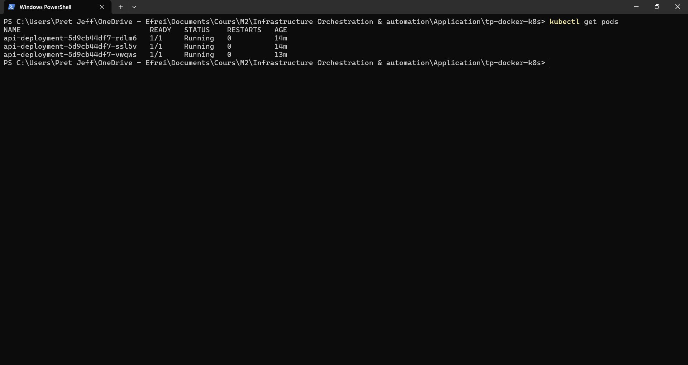
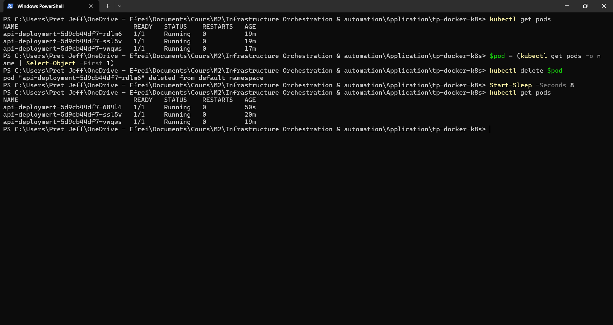
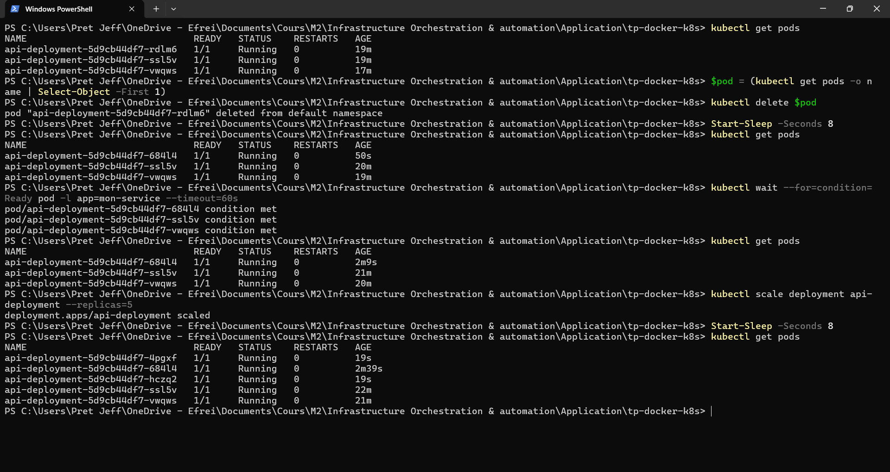

# TP Jour 2 : Containerisation avec Docker, déploiement avec Kubernetes

- **Module** : Infrastructure Orchestration & Automation, Bloc 3
- **Enseignant** : Dr. Abdelhak TOUITI
- **Compétences visées** : C7.1, C8.2
- **Auteur** : Jeff Donaïc GBANZIALI WISSANGA, EFREI Paris
- **Environnement** : Windows 11, PowerShell, Docker Desktop, Minikube v1.39.0 (driver Docker), kubectl v1.34.1, Kubernetes v1.37.0

---

## Sommaire

1. Objectif et architecture
2. Structure du dépôt
3. Étape 1 : API minimale
4. Étape 2 : Dockerfile et image
5. Étape 3 : Docker Compose (API et base de données)
6. Étape 4 : Persistance des données
7. Externalisation des identifiants (.env)
8. Étape 5 : Cluster Kubernetes local (Minikube)
9. Étape 6 : Déploiement sur Kubernetes
10. Étape 7 : Résilience et montée en charge
11. Test de l'API depuis la machine hôte
12. Étape 8 : Versionnement Git
13. Problèmes rencontrés et résolutions
14. Réponses aux questions de compréhension
15. Limites et pistes d'amélioration
16. Nettoyage

---

## 1. Objectif et architecture

Le TP consiste à containeriser un service data simple (une API Flask et une base PostgreSQL), à le faire fonctionner localement avec Docker Compose, puis à le déployer sur un cluster Kubernetes local pour observer l'auto-réparation et la montée en charge.

Deux environnements d'exécution sont utilisés :

| Environnement | Composants | Rôle |
|---|---|---|
| Docker Compose | API (`api`) et PostgreSQL (`db`), volume `donnees_db` | Stack complète en local, avec persistance |
| Kubernetes (Minikube) | Deployment `api-deployment` (3 réplicas), Service `api-service` (NodePort) | Observation de la résilience et du scaling |

Choix de périmètre conforme au sujet : sur Kubernetes, seule l'API est déployée. La base reste sur Docker Compose. Par conséquent, l'endpoint `/ventes` n'est pas fonctionnel dans le cluster (voir section 11).

---

## 2. Structure du dépôt

```
tp-docker-k8s/
├── api/
│   ├── app.py
│   ├── requirements.txt
│   ├── init.sql
│   └── Dockerfile
├── docker-compose.yml
├── deployment.yaml
├── service.yaml
├── .env 
├── .gitignore
└── README.md
```

---

## 3. Étape 1 : API minimale

Le dossier `api/` contient trois fichiers fournis par le sujet.

- `app.py` : application Flask exposant `/health` (état du service) et `/ventes` (lecture de la table `ventes` dans PostgreSQL). La connexion à la base est paramétrée par les variables d'environnement `DB_HOST`, `DB_NAME`, `DB_USER` et `DB_PASSWORD`.
- `requirements.txt` : `flask==3.0.3` et `psycopg2-binary==2.9.9`.
- `init.sql` : création de la table `ventes` et insertion de deux lignes de démonstration. Ce script est exécuté automatiquement par PostgreSQL à la première initialisation du volume.

---

## 4. Étape 2 : Dockerfile et image

Fichier `api/Dockerfile` :

```dockerfile
FROM python:3.12-slim
WORKDIR /app
COPY requirements.txt .
RUN pip install --no-cache-dir -r requirements.txt
COPY . .
CMD ["python", "app.py"]
```

Les instructions sont ordonnées de manière à exploiter le cache de couches : le fichier `requirements.txt` est copié et les dépendances installées avant la copie du code. Une modification du code applicatif ne provoque donc pas de réinstallation des dépendances.

Construction et vérification :

```powershell
cd api
docker build -t mon-service:1.0 .
docker images mon-service
cd ..
```

Résultat attendu : une ligne `mon-service   1.0` dans la liste des images.

---

## 5. Étape 3 : Docker Compose

Fichier `docker-compose.yml` (version finale, avec variables issues du `.env`) :

```yaml
services:
  api:
    build: ./api
    ports:
      - "8000:8000"
    environment:
      DB_HOST: db
      DB_NAME: ${DB_NAME}
      DB_USER: ${DB_USER}
      DB_PASSWORD: ${DB_PASSWORD}
    depends_on:
      - db
  db:
    image: postgres:16
    environment:
      POSTGRES_DB: ${DB_NAME}
      POSTGRES_USER: ${DB_USER}
      POSTGRES_PASSWORD: ${DB_PASSWORD}
    volumes:
      - donnees_db:/var/lib/postgresql/data
      - ./api/init.sql:/docker-entrypoint-initdb.d/init.sql

volumes:
  donnees_db:
```

Validation de la syntaxe puis démarrage :

```powershell
docker compose config
docker compose up -d
docker compose ps
```

Tests de l'API :

```powershell
Invoke-RestMethod http://localhost:8000/health
Invoke-RestMethod http://localhost:8000/ventes
```

Résultats attendus :

- `/health` renvoie `status : ok`.
- `/ventes` renvoie les deux lignes insérées par `init.sql` (Abonnement A, 120.00 et Abonnement B, 89.90).

Sous PowerShell, `Invoke-RestMethod` est préféré à `curl` (alias d'`Invoke-WebRequest`) car il affiche directement le JSON désérialisé.

---

## 6. Étape 4 : Persistance des données

```powershell
docker compose down
docker compose up -d
Invoke-RestMethod http://localhost:8000/ventes
```

Résultat attendu : les données sont toujours présentes, car elles sont stockées dans le volume nommé `donnees_db`, indépendant du cycle de vie des conteneurs.

Contre-épreuve (perte volontaire des données) :

```powershell
docker compose down -v
docker compose up -d
```

L'option `-v` supprime le volume. Au redémarrage, PostgreSQL réinitialise la base et rejoue `init.sql`. Cela démontre que la persistance repose sur le volume et non sur le conteneur.

---

## 7. Externalisation des identifiants (.env)

Le sujet place les identifiants en clair dans `docker-compose.yml`. Par bonne pratique, ils ont été déplacés dans un fichier `.env` situé à la racine, lu automatiquement par Docker Compose.

Fichier `.env` :

```
DB_NAME=ventes
DB_USER=postgres
DB_PASSWORD=postgres
```

Protection dans Git :

```powershell
Add-Content .gitignore ".env"
Copy-Item .env .env.example
```

Le fichier `.env` est ignoré par Git, tandis que `.env.example` (modèle sans secret réel) est versionné. Pour lancer le projet depuis un clone du dépôt, il faut d'abord copier `.env.example` en `.env`.

Remarque : si le mot de passe est modifié, il faut supprimer le volume (`docker compose down -v`), car PostgreSQL n'applique le mot de passe qu'à la première création du volume.

---

## 8. Étape 5 : Cluster Kubernetes local (Minikube)

Installation :

```powershell
winget install --id Kubernetes.minikube
winget install -e --id Kubernetes.kubectl
minikube version
kubectl version --client
```

Démarrage du cluster (Docker Desktop doit être lancé) :

```powershell
minikube start --driver=docker
kubectl get nodes
```

Le premier démarrage télécharge l'image du cluster (environ 500 Mo) et les binaires Kubernetes. Juste après le démarrage, le node apparaît brièvement en `NotReady`, puis passe en `Ready` après une à deux minutes :

```
NAME       STATUS   ROLES           AGE    VERSION
minikube   Ready    control-plane   2m1s   v1.37.0
```

Minikube a signalé un écart de version entre `kubectl` (1.34.1) et le cluster (1.37.0). Cet écart n'a pas eu d'impact sur le TP.

---

## 9. Étape 6 : Déploiement sur Kubernetes

### 9.1 Mise à disposition de l'image dans le cluster

Minikube exécute son propre moteur de conteneurs, distinct de celui de Docker Desktop. L'image locale doit donc être chargée explicitement :

```powershell
minikube image load mon-service:1.0
minikube image ls
```

### 9.2 Création du Secret

Le mot de passe de la base est fourni au pod via un Secret Kubernetes plutôt qu'en clair dans le manifeste :

```powershell
kubectl create secret generic db-secret --from-literal=DB_PASSWORD=postgres
```

### 9.3 Manifeste `deployment.yaml`

```yaml
apiVersion: apps/v1
kind: Deployment
metadata:
  name: api-deployment
spec:
  replicas: 3
  selector:
    matchLabels:
      app: mon-service
  template:
    metadata:
      labels:
        app: mon-service
    spec:
      containers:
        - name: api
          image: mon-service:1.0
          ports:
            - containerPort: 8000
          env:
            - name: DB_HOST
              value: db
            - name: DB_PASSWORD
              valueFrom:
                secretKeyRef:
                  name: db-secret
                  key: DB_PASSWORD
```

### 9.4 Manifeste `service.yaml`

```yaml
apiVersion: v1
kind: Service
metadata:
  name: api-service
spec:
  selector:
    app: mon-service
  ports:
    - port: 8000
      targetPort: 8000
  type: NodePort
```

Le lien entre le Service et les pods repose sur le label `app: mon-service`, présent dans le `selector` du Service, dans le `matchLabels` du Deployment et dans les labels du template de pod.

### 9.5 Application des manifestes

```powershell
kubectl apply -f deployment.yaml
kubectl apply -f service.yaml
kubectl get pods
kubectl get svc
```

Résultat obtenu : trois pods `1/1 Running` et un Service `api-service` de type NodePort exposé sur `8000:32465/TCP`.

```
NAME                              READY   STATUS    RESTARTS   AGE
api-deployment-5d9cb44df7-dd5td   1/1     Running   0          4s
api-deployment-5d9cb44df7-rdlm6   1/1     Running   0          4s
api-deployment-5d9cb44df7-ssl5v   1/1     Running   0          3s
```

**Capture 1 : trois réplicas Running**



---

## 10. Étape 7 : Résilience et montée en charge

### 10.1 Auto-réparation

```powershell
kubectl get pods
kubectl delete pod api-deployment-5d9cb44df7-dd5td
kubectl get pods
```

Avant suppression : `dd5td`, `rdlm6`, `ssl5v`. Après suppression, un nouveau pod `vwqws` est apparu immédiatement, ramenant le total à trois réplicas sans aucune intervention :

```
NAME                              READY   STATUS    RESTARTS   AGE
api-deployment-5d9cb44df7-rdlm6   1/1     Running   0          100s
api-deployment-5d9cb44df7-ssl5v   1/1     Running   0          99s
api-deployment-5d9cb44df7-vwqws   1/1     Running   0          31s
```

**Capture 2 : auto-réparation après suppression d'un pod**



### 10.2 Montée en charge

```powershell
kubectl scale deployment api-deployment --replicas=5
kubectl get pods
```

Cinq pods sont passés à l'état `Running`. Les deux nouveaux (`4rdqk` et `vr44s`) ont été créés en moins d'une seconde :

```
NAME                              READY   STATUS    RESTARTS   AGE
api-deployment-5d9cb44df7-4rdqk   1/1     Running   0          1s
api-deployment-5d9cb44df7-rdlm6   1/1     Running   0          2m19s
api-deployment-5d9cb44df7-ssl5v   1/1     Running   0          2m18s
api-deployment-5d9cb44df7-vr44s   1/1     Running   0          1s
api-deployment-5d9cb44df7-vwqws   1/1     Running   0          70s
```

**Capture 3 : montée en charge à 5 réplicas**



Retour à l'état déclaré dans le manifeste :

```powershell
kubectl scale deployment api-deployment --replicas=3
kubectl get pods
```

Les deux pods en excès passent par l'état `Terminating` puis disparaissent.

---

## 11. Test de l'API depuis la machine hôte

Avec le driver Docker sous Windows, le cluster n'est pas directement joignable depuis l'hôte. Deux méthodes ont été utilisées, chacune nécessitant un terminal qui reste ouvert.

Méthode 1 : tunnel Minikube

```powershell
# Terminal 1 (à garder ouvert)
minikube service api-service --url

# Terminal 2
Invoke-RestMethod http://127.0.0.1:<port-affiché>/health
```

Méthode 2 : redirection de port

```powershell
# Terminal 1 (à garder ouvert)
kubectl port-forward service/api-service 8000:8000

# Terminal 2
Invoke-RestMethod http://localhost:8000/health
```

Résultat obtenu avec les deux méthodes :

```
status
------
ok
```

Cela confirme que le Service route correctement le trafic vers les pods. Pour la méthode 2, le port local 8000 doit être libre : si la stack Docker Compose est encore active, utiliser un autre port local (par exemple `8080:8000`).

L'endpoint `/ventes` échoue dans le cluster, ce qui est attendu : la base de données n'y est pas déployée et le nom `db` n'est pas résolvable depuis les pods.

---

## 12. Étape 8 : Versionnement Git

La commande du sujet `git add Dockerfile docker-compose.yml deployment.yaml service.yaml api/` échoue en partie, car le `Dockerfile` se trouve dans `api/` et non à la racine. Tous les fichiers sont donc ajoutés avec `git add .`.

```powershell
git init
git add .
git status
git commit -m "TP Jour 2 : containerisation et deploiement Kubernetes"
git log --oneline
```

Avant le commit, `git status` permet de vérifier que `.env` n'apparaît pas dans les fichiers suivis.

Prérequis pour rejouer les manifestes sur un autre cluster : créer le Secret référencé par le Deployment avant l'application.

```powershell
kubectl create secret generic db-secret --from-literal=DB_PASSWORD=postgres
```

---

## 13. Problèmes rencontrés et résolutions

| Symptôme | Cause | Résolution |
|---|---|---|
| `minikube image load` : image non trouvée | L'image avait été construite avec un nom erroné (`mon-ervice:1.0`) | `docker tag mon-ervice:1.0 mon-service:1.0`, puis suppression de l'étiquette erronée avec `docker rmi mon-ervice:1.0` |
| Node en `NotReady` juste après `minikube start` | Le node était encore en cours d'initialisation (27 secondes) | Attente d'environ deux minutes, le node est passé en `Ready` |
| `kubectl apply -f deployement.yaml` : fichier introuvable | Faute de frappe dans le nom du fichier | Relance avec `deployment.yaml` |
| Pods en `CreateContainerConfigError` | Le Deployment référençait le Secret `db-secret`, non encore créé. L'événement `secret "db-secret" not found` est visible avec `kubectl describe pod` | Création du Secret, puis `kubectl delete pod -l app=mon-service` pour forcer la recréation des pods |
| `Invoke-RestMethod` : impossible de se connecter | Le tunnel de `minikube service --url` se ferme quand la commande rend la main dans la même fenêtre | Utilisation de deux terminaux, ou de `kubectl port-forward` |
| Erreur d'indentation dans les fichiers YAML | Niveaux de structure incorrects dans `docker-compose.yml` | Réécriture avec 2 espaces par niveau, validation avec `docker compose config` et `kubectl apply --dry-run=client` |

Commande de diagnostic la plus utile : `kubectl describe pod <nom>`, dont la section `Events` indique la cause exacte d'un échec de démarrage.

---

## 14. Réponses aux questions de compréhension

### Question 1 : Quelle est la différence entre une image Docker et un conteneur Docker ?

Une image est un modèle figé et immuable, composé de couches empilées, qui contient l'application et son environnement d'exécution. Elle est produite par `docker build` à partir d'un Dockerfile. Un conteneur est une instance en cours d'exécution de cette image, créée par `docker run`. À partir d'une même image, on peut lancer plusieurs conteneurs indépendants. Le conteneur ajoute à l'image une couche inscriptible éphémère et possède un cycle de vie propre (créé, démarré, arrêté, supprimé). Dans ce TP, `mon-service:1.0` est l'image, et chaque pod Kubernetes exécute un conteneur issu de cette image.

### Question 2 : Pourquoi les données de la base sont-elles perdues si l'on supprime le volume, mais pas si l'on supprime seulement le conteneur ?

Le système de fichiers d'un conteneur est éphémère : tout ce qui y est écrit disparaît avec lui. Les données de PostgreSQL sont écrites dans `/var/lib/postgresql/data`, qui est monté depuis le volume nommé `donnees_db`. Ce volume est géré par Docker en dehors du cycle de vie du conteneur. Supprimer le conteneur (`docker compose down`) laisse le volume intact, et le nouveau conteneur retrouve les données au redémarrage. Supprimer le volume (`docker compose down -v`) détruit l'unique emplacement où les données étaient stockées. Au démarrage suivant, PostgreSQL réinitialise la base et rejoue `init.sql`.

### Question 3 : Un Deployment Kubernetes déclaré avec `replicas: 3` perd un pod. Que fait Kubernetes, et pourquoi parle-t-on d'approche déclarative ?

Le ReplicaSet géré par le Deployment constate que le nombre de pods en cours d'exécution (2) est inférieur à l'état désiré (3) et crée automatiquement un nouveau pod. Cela a été observé dans le TP : après la suppression de `dd5td`, le pod `vwqws` est apparu en quelques secondes. L'approche est dite déclarative car l'utilisateur décrit l'état souhaité (trois réplicas de cette image) et non la suite d'actions à effectuer. Kubernetes compare en permanence l'état réel à l'état désiré et corrige les écarts de lui-même (boucle de réconciliation). À l'inverse, une approche impérative demanderait de lancer manuellement un conteneur de remplacement.

### Question 4 : Quel est le rôle du Service par rapport aux pods, sachant que ces derniers sont recréés régulièrement avec une nouvelle adresse IP ?

Les pods sont éphémères : leur nom et leur adresse IP changent à chaque recréation. Le Service fournit un point d'accès réseau stable (adresse virtuelle et nom DNS constants) vers un ensemble de pods. Il sélectionne ses pods par labels (`selector: app: mon-service`) et non par nom ou par IP, de sorte que tout pod portant ce label est automatiquement pris en compte, y compris un pod fraîchement recréé. Le Service répartit en outre le trafic entre les pods disponibles. Les clients n'ont donc jamais besoin de connaître l'adresse d'un pod particulier. Dans ce TP, le type NodePort expose en plus l'API à l'extérieur du cluster via un port fixe du node.

### Question 5 : Citez deux limites de Docker seul (sans Kubernetes) que vous avez observées ou apprises.

1. **Pas de redémarrage ni de réparation automatique à l'échelle du service** : si un conteneur plante ou est supprimé, rien ne le recrée pour rétablir un nombre voulu d'instances. Dans le TP, c'est Kubernetes qui a remplacé automatiquement le pod supprimé.
2. **Pas de montée en charge ni de répartition de charge automatiques, et limité à une seule machine** : Docker gère les conteneurs d'un seul hôte, sans mécanisme natif pour ajuster le nombre d'instances selon la demande ni pour répartir le trafic entre elles. Avec Kubernetes, un simple `kubectl scale` a fait passer le service de 3 à 5 réplicas.

---

## 15. Limites et pistes d'amélioration

- Déployer PostgreSQL sur Kubernetes (Deployment, Service et PersistentVolumeClaim) afin de disposer d'une stack entièrement dans le cluster. Le Service de la base devrait alors s'appeler `db`, ce qui rendrait `DB_HOST=db` résolvable et activerait `/ventes`.
- Externaliser également `DB_NAME` et `DB_USER` dans le Secret ou dans une ConfigMap.
- Ajouter des sondes `readinessProbe` et `livenessProbe` sur le conteneur `api`, pointant vers `/health`, pour que Kubernetes détecte les pods défaillants ou non prêts.
- Remplacer le serveur de développement Flask par un serveur WSGI de production (par exemple gunicorn).
- Épingler des versions précises des images de base et utiliser un registry plutôt que `minikube image load`.

---

## 16. Nettoyage

À effectuer une fois le rendu validé :

```powershell
kubectl delete -f service.yaml
kubectl delete -f deployment.yaml
kubectl delete secret db-secret
minikube stop
docker compose down
```

Pour supprimer aussi les données de la base : `docker compose down -v`. Pour supprimer entièrement le cluster : `minikube delete`.
